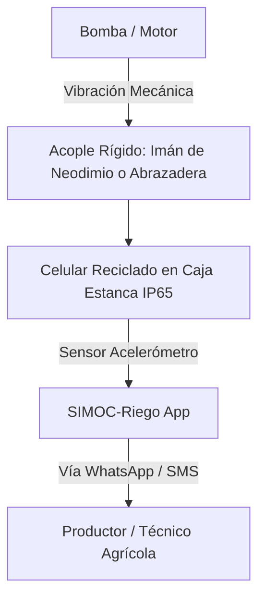

# 🌊 SIMOC-Riego
### Sistema de Monitoreo y Control de Riego Agrícola
> **Vigilante de vibración y mantenimiento predictivo para bombas de riego agrícolas utilizando celulares reciclados.**

[-00C853?style=for-the-badge&logo=sqlite&logoColor=white)](https://developer.android.com/training/data-storage/room)

---

## 📖 Descripción del Proyecto

En el sector agrícola, la parada inesperada o falla catastrófica de una electrobomba o motobomba de riego (por desgaste de rodamientos, desbalance del impulsor o cavitación) no solo significa costosas reparaciones de bobinado y rectificación ($300 – $2,500+ USD), sino también la pérdida crítica de ciclos de riego en las cosechas.

Los sistemas de monitoreo y análisis de vibraciones industriales tradicionales suelen ser inaccesibles para pequeños y medianos productores debido a sus altos costos de adquisición e integración.

**SIMOC-Riego** transforma **teléfonos móviles en desuso o reciclados** en **centinelas IoT de borde (*edge devices*)**. Aprovechando el acelerómetro triaxial de alta precisión, la capacidad de cómputo y la conectividad del teléfono, el sistema supervisa la vibración mecánica continua de la bomba, clasifica su severidad bajo la norma **ISO 10816** y emite alertas preventivas antes de que el motor sufra daños irreversibles.

---

## ✨ Características Principales

### 🚦 1. Semáforo Industrial en Tiempo Real (Norma ISO 10816)
* **Pantalla de alta visibilidad:** Diseñada para ser legible a la distancia dentro de la caseta de bombeo.
* **Métricas clave en vivo:**
  * **RMS ($m/s^2$):** Valor cuadrático medio para evaluar la energía destructiva de la vibración.
  * **Frecuencia Pico (Hz):** Detección de armónicos fundamentales (1X RPM, 2X, etc.).
  * **Amplitud Pico a Pico ($m/s^2$):** Rango de desplazamiento dinámico.
  * **Relación vs. Línea Base:** Factor de incremento respecto a la vibración normal del equipo ($x$ veces sobre lo calibrado).
* **Zonificación Estándar:**
  * 🟢 **Zona A / B (Normal):** Operación admisible y rodamientos estables.
  * 🟡 **Zona C (Alerta Preventiva):** Vibración elevada; requiere engrase o inspección mecánica programada.
  * 🔴 **Zona D (Peligro Crítico):** Riesgo inminente por desbalance severo, soltura o cavitación.
* **Osciloscopio Digital:** Gráfica de onda continua (*Waveform Canvas*) renderizada en tiempo real.

### 🎯 2. Asistente de Calibración de Línea Base (10s)
* Procedimiento guiado de 10 segundos con el motor operando en condiciones óptimas para registrar el **RMS basal** y la **frecuencia nominal**.
* Los umbrales de advertencia y peligro se adaptan automáticamente a cualquier modelo, potencia o tipo de bomba.

### 🧪 3. Simulador de Fallas Mecánicas Integrado
Permite validar, capacitar y realizar demostraciones sin someter a esfuerzo un motor real:
* 🟢 *Operación Normal (1.9 m/s²)*
* 🟡 *Falta de Lubricación / Fricción leve (2.5 m/s²)*
* 🟡 *Desgaste en Pista de Rodamientos (3.2 m/s²)*
* 🔴 *Desbalance Severo de Impulsor / Eje descentrado (4.7 m/s²)*
* 🔴 *Cavitación Crítica (Implosión errática de burbujas en succión)*
* ⚪ *Bomba en Reposo / Apagada (<0.1 m/s²)*

### 📲 4. Alertas de Baja Latencia (WhatsApp y SMS)
* Envío de reportes comprimidos y directos al celular del productor, regador o cooperativa.
* No requiere servidores complejos ni conexiones de alto ancho de banda: funciona vía enlace directo a WhatsApp o mediante SMS estándar.

### 💾 5. Arquitectura 100% Offline-First (Room DB)
* Telemetría registrada periódicamente (cada 15 segundos) en base de datos local SQLite (Room).
* Funciona de forma totalmente autónoma en pozos profundos y zonas rurales sin cobertura de datos.
* Exportación de reportes de diagnóstico a texto plano mediante el menú nativo de compartir de Android.

### 💰 6. Bitácora e Impacto Económico
* Calculadora de ahorro acumulado en reparaciones mecánicas y rebobinados evitados.
* Registro de tareas de mantenimiento preventivo (cambio de rodamientos, reapriete de anclajes, engrase).

---

## 🛠️ Guía de Montaje e Instalación Física

Para obtener mediciones fidedignas y proteger el teléfono:

### ⚙️ 7. Mejoras de Grado Industrial Implementadas
1. **Centinela 24/7 (Foreground Service + WakeLock):** Monitoreo ininterrumpido en segundo plano aunque la pantalla esté apagada.
2. **Auto-Arranque tras Cortes de Luz (`BOOT_COMPLETED`):** Inicia automáticamente la vigilancia cuando el teléfono recibe corriente.
3. **Modo Pantalla Negra OLED (Anti Burn-in):** Reduce el consumo energético y previene el desgaste de píxeles en la caseta.
4. **Análisis Espectral FFT Real (0 - 50 Hz):** Detección de armónicos 1X RPM (giro) y 2X RPM (desalineación).
5. **Detección Acústica de Cavitación (Micrófono 2 - 8 kHz):** Detección de implosión de burbujas en succión.
6. **Alertas Autónomas (SMS sin intervención + Telegram Bot / Webhook):** Alerta a deshoras sin requerir interacción manual.
7. **Diagnóstico Inteligente con Gemini AI:** Análisis de causa raíz y pasos de inspección física en terreno.
